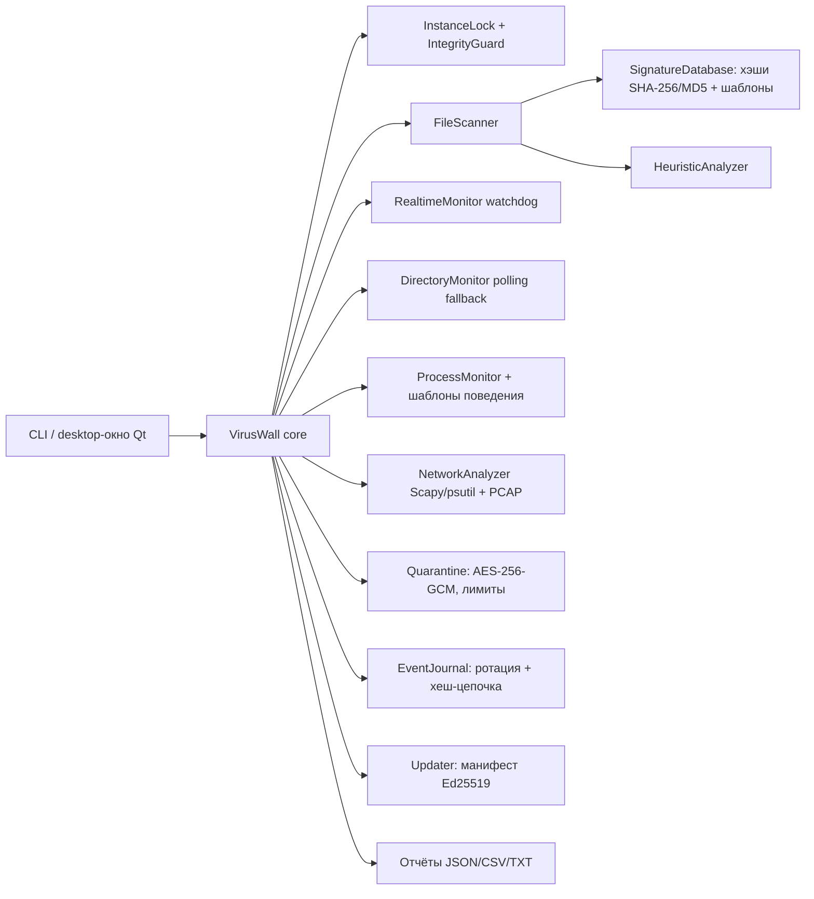

# Архитектура VirusWall

Документы лабораторных №1–2 (`01_Техническое_задание.docx`, `06_Архитектура_и_техническая_документация.docx`) задают модульную структуру: центральный сервис, сканер, сигнатурный/эвристический/поведенческий анализ, карантин, обновления, журналирование, уведомления, конфигурация и самозащита. Пакет `viruswall` реализует эту структуру на уровне пользовательского приложения (без системного демона и драйвера — граница зафиксирована в [COVERAGE.md](COVERAGE.md)).

`FileScanner` вычисляет SHA-256 и MD5 за один потоковый проход и проверяет хеш-сигнатуры и байтовые шаблоны (по первым до 2 МБ файла). Повреждённая база сигнатур автоматически заменяется резервной копией (событие и флаг `database_recovered_from_backup` в `status`). `RealtimeMonitor` подписывается на события ОС через watchdog и запускает конвейер «событие → журнал → сканирование → политика»; политика `quarantine` автоматически изолирует объекты только после явного включения (`arm`). Направление защиты журналируется с задержкой реакции (`reaction_ms`).

`ProcessMonitor` коррелирует новые процессы с настроенными шаблонами `behavior_templates` (глобы родитель/потомок) и правилом «исполняемый из временного каталога». `NetworkAnalyzer` оценивает соединения psutil и метаданные пакетов Scapy по скользящему окну, агрегирует потоки и разбирает PCAP-файлы (`analyze_pcap`).

`EventJournal` пишет JSONL-записи с `event_id` (uuid), `engine_version`, `database_version` и хеш-цепочкой (`prev_hash`/`chain_hash`); подмена записи обнаруживается `verify()`. Ротация по 100 МБ, каждый ротированный файл проверяется независимо. `Quarantine` шифрует копию AES-256-GCM, контролирует лимиты (размер/количество/срок), выполняет безопасное удаление с перезаписью сектора случайными байтами, помечает восстановленные объекты и допускает повторное сканирование после восстановления. `Updater` проверяет подпись Ed25519 открытого ключом из конфигурации и применяет манифест атомарно; при отказе база откатывается к рабочей версии.

`InstanceLock` не даёт запустить второй экземпляр на каталог данных (flock/LK_NBLCK). `IntegrityGuard` хранит контрольные суммы конфигурации и базы; изменения вне приложения порождают события `tamper_detected`. `doctor` выполняет самотестирование (зависимости, backend реального времени, права, ключ карантина, целостность журнала, диск).

Конфигурация `config.json` валидируется по схеме (неизвестные параметры отклоняются), резервная копия создаётся перед каждым изменением (`config.json.bak`). Разделы: `modules`, `exclusions` (пути и маски), `realtime`, `quarantine`, `logging`, `network_rules`, `behavior_templates`, `updates`.

Ограничения: опрос не гарантирует обнаружения кратковременного файла между снимками (native-бэкенд устраняет окно для типовых сценариев); список процессов/соединений зависит от прав ОС; захват пакетов требует повышенных прав и драйвера; блокировки операций ОС уровня драйвера и системный демон не реализованы — защита действует на уровне приложения.
