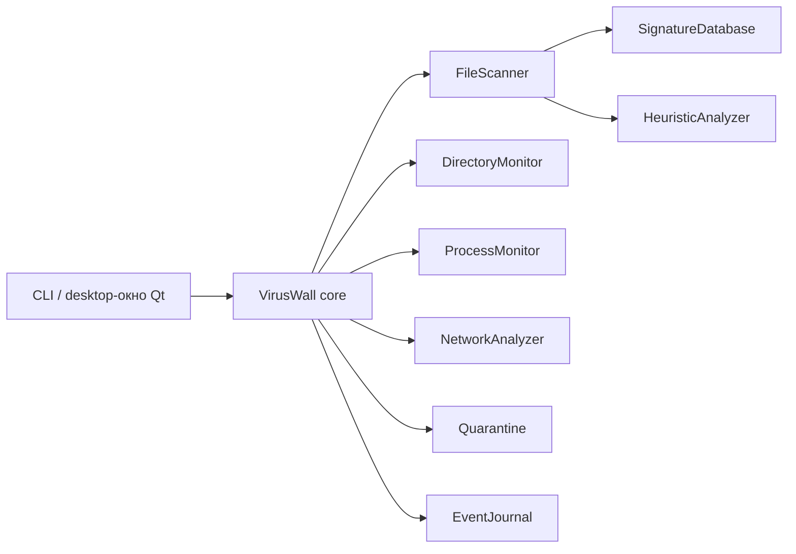

# Архитектура VirusWall

Исходные документы лабораторных №1–2 описывают центральный сервис, сканер, сигнатурный, эвристический и поведенческий анализ, карантин и журнал. Реализованное приложение сохраняет это логическое разделение в пакете `viruswall`. Отдельного системного демона и драйвера перехвата пока нет; CLI и desktop-интерфейс запускают модули как обычный пользовательский процесс.

`FileScanner` вычисляет SHA-256 потоково и передаёт файл анализаторам. `DirectoryMonitor` опрашивает выбранный каталог и передаёт события создания/изменения в `VirusWall.handle_file_event`. `ProcessMonitor` снимает список процессов через psutil и ищет новые процессы между снимками. `NetworkAnalyzer` оценивает соединения psutil и метаданные IP/TCP/UDP/DNS из Scapy. Модули не изменяют процессы и соединения.

`VirusWall` превращает обнаружения в `SecurityEvent`, сохраняет их через `EventJournal` и предоставляет операции карантина. Сетевой анализатор объединяет метаданные пакетов в потоки по адресам, портам и протоколу и считает пакеты/байты за окно времени. `Quarantine` шифрует копию AES-256-GCM, хранит ключ только локально с правами текущего пользователя и проверяет целостность при восстановлении. Удаление оригинала возможно только по отдельному явному запросу. Публичные интерфейсы перечислены в [API.md](API.md).

Конфигурация `config.json` включает/отключает модули, задаёт исключения, чувствительность эвристики, выбранный каталог и сетевые правила. База `signatures.json` содержит локальные SHA-256. Журнал `events.jsonl` содержит только метаданные обнаружений. Папка `quarantine/` содержит шифрованные копии, ключ и JSON-метаданные. Все файлы данных создаются в каталоге `--data-dir`.

Ограничения: опрос файлового каталога не гарантирует обнаружения кратковременного файла между опросами; список процессов и соединений зависит от прав ОС; для захвата пакетов может потребоваться повышенное разрешение и драйвер; направление TCP определяется приблизительно по слушающему порту, направление UDP обозначается `unknown`. Для реальной защиты в режиме блокировки потребовались бы платформенные компоненты Windows/Linux/macOS и отдельные испытания.
